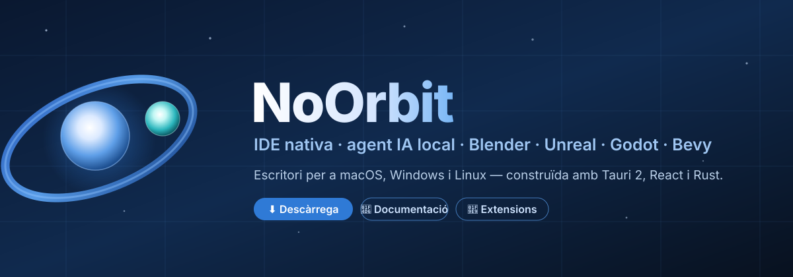
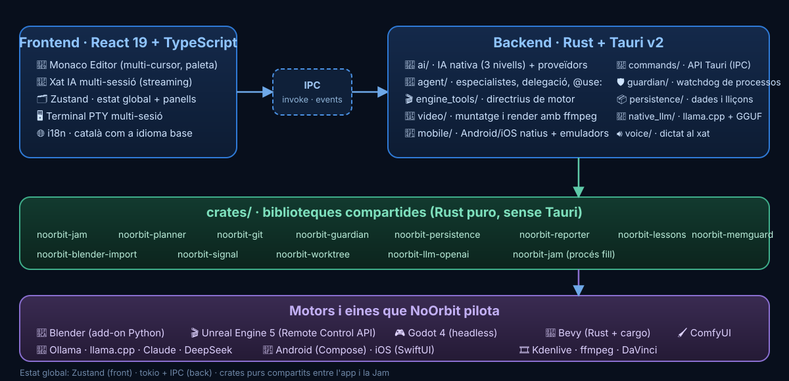
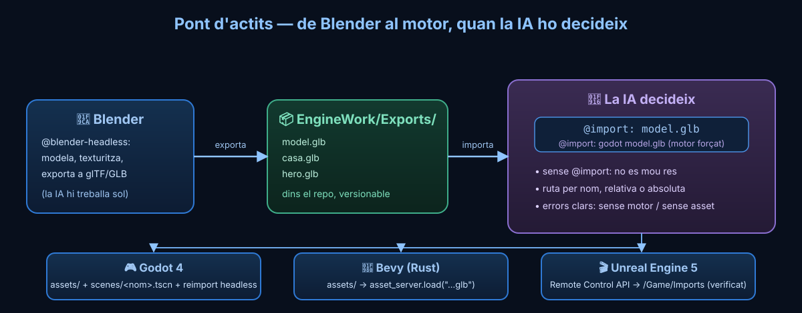

<p align="center">
  
</p>

<p align="center">
  <a href="https://github.com/jpuigbert/noorbit/releases/latest"></a>
  <a href="https://github.com/jpuigbert/noorbit/actions/workflows/ci.yml"></a>
  <a href="https://github.com/jpuigbert/noorbit/actions/workflows/release.yml"></a>
  <a href="LICENSE"></a>
  
  
</p>

---

## Què és NoOrbit

**NoOrbit és una IDE d'escriptori que treballa sola.** No és un editor de codi amb un xat
d'IA afegit al costat: és un entorn on un **agent autònom** rep un encàrrec, fa un pla,
escriu el codi **fitxer a fitxer**, ho executa, ho verifica, ho commiteja i torna a
fer-ho tot sol durant les hores que tu li deixis — fins a set dies seguits.

Al mateix temps, NoOrbit és una **IDE de veritat**: editor Monaco, terminal PTY real,
git, depuració, emuladors mòbils natius, extensions, skills i servidors MCP. I connecta
amb les eines que de debò es fan servir per produir contingut: **Blender**, **Unreal
Engine 5**, **Godot 4** i **Bevy**.

Tres idees sostenen el projecte:

1. **La IA ha de poder treballar, no només parlar.** Materialitza fitxers reals al
   projecte *mentre encara està escrivint*, executa ordres reals (Blender, Unreal,
   Godot, Bevy, `cargo`, `ffmpeg`) i torna els errors de veritat al model perquè els
   corregeixi.
2. **Ha de funcionar al teu ordinador, no al de ningú altre.** L'IA nativa va **dins el
   binari**: en instal·lar NoOrbit ja tens una IA que calcula, coneix i conversa, sense
   baixar cap model ni fer servir la GPU. Si vols més, hi connectes Ollama, llama.cpp,
   Claude o DeepSeek.
3. **Ninguna dada surt de la màquina.** Les claus API viuen a la carpeta de dades del
   sistema, mai al repositori. L'aprenentatge, el dataset i els models són locals.

<p align="center">
  
</p>

### Què hi ha dins

| Àmbit | Què inclou |
|---|---|
| **Agent autònom** | Planificador, codegen, verificador i *checkpoint* en crates propis. Executa en un procés fill: si es penja, l'app no. |
| **Jam multi-dia** | Fins a **7 dies** de treball continuat, amb barra de progrés, **ETA**, temps personalitzable i aturada real (no decorativa). |
| **Treball autopilotat** | Menú «IA ▸ Treball autopilotat»: la IA millora sola **qualsevol** projecte (WordPress, jocs, codi) durant el temps triat, sense tocar l'ordinador. |
| **Editor** | Monaco amb multi-cursor, Quick Open, cerca global, Command Palette, pestanes i git diff integrat. |
| **Terminal** | PTY real multi-sessió connectat al backend Rust. |
| **IA** | Xat multi-sessió amb streaming en viu, **materialització automàtica** de fitxers, reintents automàtics si l'equip es queda sense memòria i **IA nativa de 3 nivells** (determinista → LLM local → fallback simbòlic). |
| **Veu** | **Dictat al xat**: un botó de micròfon al composer. Tres motors: macOS Speech, whisper.cpp local o qualsevol proveïdor compatible OpenAI. |
| **Motors** | **Blender** (add-on Python), **Unreal Engine 5** (Remote Control API + agent MCP), **Godot 4** (headless) i **Bevy** (Rust + `cargo`): la IA hi treballa i hi construeix, no només hi parla. |
| **Pont d'actius** | El que la IA crea a Blender **arriba al joc**: exporta a `EngineWork/Exports/` i, quan la IA ho decideix, s'importa a Godot, Bevy o Unreal. |
| **Vídeo** | Menú «Vídeo» propi: la IA **munta, es critica i renderitza** (fins a 24 h de pressupost) amb `ffmpeg` i Kdenlive. |
| **Mòbil natiu** | Android (Kotlin + Compose + Material 3) i iOS (Swift + SwiftUI), gestió d'AVDs i simuladors, *live view* amb captures periòdiques. |
| **Imatges** | ComfyUI local, rodet de CPU (stable-diffusion.cpp), proveïdors en línia (OpenAI, Venice, **Muapi.ai / Open Higgsfield / Open Generative AI** — 200+ models). |
| **Extensions** | Skills (carpetes amb `SKILL.md`), plugins natius, servidors **MCP** i **328 skills + 72 especialistes ECC** de sèrie dins l'instal·lador. |
| **Especialistes** | Rols amb model, temperatura i prompt propis, que es poden **delegar** entre ells (`@use:`) i veure l'equip que tenen al costat. |
| **Aprenentatge local** | La IA **aprèn de les altres IAs**: registra les converses, en destil·la **lliçons** i les torna als xats futurs. Dataset exportable en JSONL per entrenar un model (LoRA). |
| **i18n** | **Català com a idioma base**, extensible amb fitxers JSON. |

---

## Novetats de la 0.71.13

*Les novetats de les versions següents (cost real dels tokens, Copilot per ACP,
l'app real provada amb clics) són a [`CHANGELOG.md`](CHANGELOG.md) i al cos de
cada release.*

### 🎮🦀 Godot 4 i Bevy: motors de primera classe

Godot i Bevy ja no són «modes»: **es detecten, s'instal·len, s'editen i la IA els pilota
igual que Blender i Unreal**.

- **Directrius reals**: `@godot: import | run [escena] | script res://fitxer.gd | version`
  executa el motor **de veritat** en headless (importa els assets, arrenca l'escena i
  torna els errors de GDScript); `@bevy: check | build | run | test | clippy` compila i
  executa amb `cargo`. El resultat torna al model, que hi pot corregir.
- **Detecció de projecte**: un `project.godot` (a l'arrel o un nivell) i un `Cargo.toml`
  amb la dependència `bevy` es detecten sols; el binari de Godot es busca a
  `/Applications`, Homebrew i al PATH, i el `cargo` a `~/.cargo/bin` (les apps llançades
  des del Finder no tenen el PATH de la shell).
- **Obrir el projecte al motor**: el botó «Obre al motor» del panell Jam obre l'editor de
  Godot, el Terminal amb `cargo run` de Bevy o l'editor d'Unreal (amb els plugins del
  pont activats abans de l'arrencada).
- **Instal·lació opcional per plataforma**: Godot 4 i Rust són passos **opcionals** de
  l'assistent, com Unreal: un clic obre la descàrrega oficial ja filtrada pel sistema
  operatiu, i NoOrbit els detecta sol quan l'usuari els instal·la.
- **Bevy a la Jam**: «🦀 Bevy (Rust)» és un motor triable, i el planner el coneix com a
  «Rust + ECS» perquè el model escrigui codi compatible.

### 📦 Pont d'actius: de Blender al joc, sense tocar res

<p align="center">
  
</p>

Si la IA necessita **generar alguna cosa en Blender**, pot fer-ho i deixar-la dins el joc:
exporta a `EngineWork/Exports/` i emet `@import: model.glb` (o `@import: godot model.glb`
per forçar el destí).

- **Godot**: l'asset es copia a `assets/`, es crea l'escena `scenes/<nom>.tscn` que
  l'instancia i es reimporta en headless.
- **Bevy**: es copia a `assets/`, on el codi Rust el llegeix amb `asset_server.load`.
- **Unreal**: s'importa **de debò** via la Remote Control API (que verifica que l'asset
  s'ha creat de veritat).

**No s'importa res automàticament: el moment d'importar el decideix la IA.** La ruta pot
ser absoluta, relativa al projecte, dins de `EngineWork/Exports/` o només el nom del
fitxer; sense motor detectat o sense asset, el missatge diu exactament què fer.

### Altres novetats

- **La Jam diu quina IA hi treballa** (proveïdor + model reals, els mateixos que rep el
  procés fill) i **«Atura» atura de debò**: la fase de pla és cancel·lable, el botó
  reflecteix l'estat i el procés fill ni tan sols arrenca si l'aturada ja s'ha demanat.
  A més, **només hi pot haver una Jam** a la vegada (reserva amb compare-and-swap).
- **Unreal Engine en un disc extern**: la cerca del motor arriba a **totes** les unitats
  montades (discs externs, NAS, xarxa), reconeix contenidors renomenats i filtrats
  falsos, i permet **triar la carpeta a mà**.
- **Menú «Vídeo» nou**: la IA munta, es critica, renderitza i **verifica** el resultat
  (durada, LUFS, plans morts, trams congelats) dins del mateix pressupost de temps.
- **Dictat al xat** amb tres motors (macOS Speech, whisper.cpp local, API OpenAI-compatible).
- **ECC de sèrie**: 328 skills, 72 especialistes i regles dins l'instal·lador, consultables
  per la IA nativa.
- **La IA crea codi, no documentació**: plantilles compilades al binari per a escenes
  Blender, animació, materials, exportació glTF per a motors i projectes Unreal lleugers.

L'historial **complet**, versió per versió, és a [`CHANGELOG.md`](CHANGELOG.md).

---

## Instal·lació (usuari final)

**👉 <https://github.com/jpuigbert/noorbit/releases/latest>**

Cada release publica els tres sistemes operatius. `<VERSIÓ>` és sempre la del
release que descarregueu (l'última publicada és la del link de dalt), així que
l'enllaç directe té aquesta forma:
`https://github.com/jpuigbert/noorbit/releases/latest/download/NoOrbit_<VERSIÓ>_universal.dmg`.

| Sistema | Fitxer | Notes |
|---|---|---|
| **macOS** (universal, Intel + Apple Silicon) | `NoOrbit_<VERSIÓ>_universal.dmg` | Signatura ad-hoc; arrossega l'app a **Aplicacions** |
| **Windows** (10 / 11) | `NoOrbit_<VERSIÓ>_x64-setup.exe` | Instal·lació per a l'usuari actual, sense drets d'administrador |
| **Linux** (Debian / Ubuntu) | `NoOrbit_<VERSIÓ>_amd64.deb` | `sudo apt install ./…deb` |
| **Linux** (Fedora / RHEL) | `NoOrbit-<VERSIÓ>-1.x86_64.rpm` | `sudo dnf install ./…rpm` |
| **Linux** (universal) | `NoOrbit_<VERSIÓ>_amd64.AppImage` | `chmod +x` i executa |

L'índex automàtic de **totes** les versions i els seus enllaços és l'asset `versions.json`
de l'últim release. Les versions velles **mai no s'esborren**.

### macOS — primera arrencada (app no signada)

NoOrbit **no està signada amb Developer ID ni notaritzada** (ho requereix un compte
d'Apple de pagament). macOS aplica *Gatekeeper* i bloqueja l'arrencada el primer cop.
**No és un error de l'app**: és el comportament de qualsevol app descarregada sense
signar.

1. Obre el `.dmg` i arrossega **NoOrbit** a la carpeta **Aplicacions**.
2. Al **Finder**, fes **clic dret** sobre **NoOrbit.app** → **Obre** → **Obre** al diàleg.
3. **Només cal fer-ho un cop.** Després s'obre amb doble clic normal.

Alternatives: *Configuració del Sistema → Privadesa i seguretat → Seguretat → «Obre de
totes maneres»*, o des del Terminal:

```bash
xattr -dr com.apple.quarantine /Applications/NoOrbit.app
```

### Windows

Doble clic a `NoOrbit_<VERSIÓ>_x64-setup.exe` → s'instal·la per a l'usuari actual
i l'executable apareix al menú Inici.

### Linux

```bash
# Debian / Ubuntu
sudo apt install ./NoOrbit_<VERSIÓ>_amd64.deb
# Fedora / RHEL
sudo dnf install ./NoOrbit-<VERSIÓ>-1.x86_64.rpm
# AppImage
chmod +x NoOrbit_<VERSIÓ>_amd64.AppImage && ./NoOrbit_<VERSIÓ>_amd64.AppImage
```

---

## Compilar des del codi font

### Requisits

| Eina | Versió mínima | Com install·lar |
|------|----------------|-----------------|
| Node.js | 20 (el CI usa 24) | <https://nodejs.org> |
| pnpm | 9 | `corepack enable` |
| Rust | 1.77 | <https://rustup.rs> |

**Dependències del sistema operatiu**:

- **macOS**: `xcode-select --install` (Command Line Tools).
- **Linux (Debian/Ubuntu)**:
  ```bash
  sudo apt update && sudo apt install -y \
    libwebkit2gtk-4.1-dev build-essential curl wget file \
    libxdo-dev libssl-dev libayatana-appindicator3-dev librsvg2-dev
  ```
- **Windows**: Microsoft **C++ Build Tools** (workload *Desktop development with C++*) +
  **WebView2 Runtime** (a Windows 11 ja ve inclòs; a Windows 10 es baixa sol gràcies a
  `webviewInstallMode: downloadBootstrapper`).

### Passos

```bash
git clone https://github.com/jpuigbert/noorbit.git
cd noorbit
pnpm install

# Mode desenvolupament (hot reload)
pnpm app:dev

# Compilar paquets segons el sistema:
pnpm app:build:mac:universal   # macOS: DMG universal (Intel + Apple Silicon)
pnpm app:build:mac:intel       # macOS: només Intel
pnpm app:build:mac:arm         # macOS: només Apple Silicon
pnpm app:build:deb             # Linux: .deb
pnpm app:build:linux           # Linux: .deb + .rpm + AppImage
pnpm app:build:win             # Windows: .exe (NSIS)
pnpm app:build                 # El paquet natiu del SO on s'està executant
```

> ⚠️ Cada instal·lador s'ha de **construir des del seu sistema operatiu** (o en CI).
> Des de macOS no es poden crear `.deb` de Linux ni `.exe` de Windows de forma fiable perquè
> enllacen biblioteques pròpies d'aquelles plataformes. El que sí es pot fer des d'un sol Mac
> és produir un **DMG universal** (Intel + Apple Silicon).

### On són els instal·ladors un cop compilats

```
apps/desktop/src-tauri/target/[<triple>]/release/bundle/
```

| Sistema | Rutes |
|---|---|
| macOS | `universal-apple-darwin/…/dmg/NoOrbit_<ver>_universal.dmg` i `…/macos/NoOrbit.app` |
| Windows | `release/bundle/nsis/NoOrbit_<ver>_x64-setup.exe` i `…/msi/NoOrbit_<ver>_x64_en-US.msi` |
| Linux | `release/bundle/deb/…deb`, `…/rpm/…rpm`, `…/appimage/…AppImage` |

---

## Com funciona per dins

```
noorbit/
├── apps/desktop/                 ← única app (Tauri)
│   ├── src/                      ← frontend React/TypeScript (components/, stores/, i18n/, editor/, core/, help/)
│   ├── src-tauri/                ← backend Rust (commands/, ai/, agent/, mobile/, blender/, unreal/, godot/, bevy/, video/, voice/, engine_tools/, engine_bridge/, engine_open/, …)
│   └── package.json
├── crates/                       ← biblioteques Rust compartides (jam, planner, git, guardian, persistence, reporter, lessons, memguard, blender-import…)
├── blender-scripts/              ← add-on Python per connectar amb Blender
├── unreal-scripts/              ← bootstrap Python per Unreal
├── docs/                         ← imatges SVG de la documentació (hero, arquitectura, pont d'actius)
├── scripts/                      ← instal·ladors i eines de build
└── site/                         ← Game Studios (site estàtic)
```

Fluxos clau:

- **Streaming IA**: el backend emet l'event `ai://chunk` etiquetat per `sessionId`; el
  frontend (`agentStore.appendStream`) acumula el text i **crida `scheduleLiveMaterialize`**
  per escriure fitxers reals a disco **en viu**, mentre el model encara està generant.
- **Reintents automàtics**: si el model local falla per `out of memory` o el stream es
  talla, NoOrbit torna a intentar-ho amb context **reduït → sense codi → sense historial**.
- **La Jam viu en un procés fill**: l'únic canal cap a la UI són línies `JAM|<json>`; si
  l'agent es penja, l'app continua i el guardian el reinicia.
- **Invoke**: comandaments Rust cridats des de TS via `invoke("name", { args })`.

---

## Jam autònom (l'agent treballa sol)

El panell **Agent ▸ Jam** deixa la IA desenvolupar el projecte durant hores o dies:
brief → pla → codi → verificació → commit, tasca a tasca.

- Usa **la IA que l'usuari tingui connectada** (local o núvol): la mateixa que fa servir
  el xat, sense cap configuració extra.
- **Protecció de memòria**: si una tasca consumeix massa, l'agent s'atura i es reintenta
  amb menys qualitat. L'equip no es congela.
- Cada pas es materialitza al projecte (blocs `@file:`), es verifica amb l'ordre que
  vulguis (`npm run build`, `godot --headless`, `cargo test`…) i es commiteja.
- Al final es genera `REPORT.md` amb el pla, els resultats i els commits.
- Motor triable: **Godot 4**, **Bevy (Rust)**, **Unreal 5**, **Unity**, **Web/HTML** o
  **mobil**.

La lògica viu als crates de [`crates/`](crates/) (`noorbit-guardian`, `noorbit-jam`,
`noorbit-planner`, `noorbit-git`, `noorbit-reporter`, …).

---

## Wiki

La documentació detallada (arquitectura, integracions, extensions, dreceres, guia de
contribució) és a:

**📚 <https://github.com/jpuigbert/noorbit/wiki>**

- [[Instalació]] · [[Funcionalitats]] · [[IA-en-NoOrbit]] · [[Treball-autopilotat]]
- [[Desenvolupament-mòbil-natiu]] · [[Integració-Blender]] · [[Integració-Unreal]]
- [[Integració-Godot-i-Bevy]] · [[Extensions]] · [[Dreceres-de-teclat]] · [[Arquitectura]] · [[Contribució]]

---

## Game Studios (site)

La plantilla i el flux «Claude Code Game Studios» (jocs de navegador a partir d'una idea)
estan integrats a NoOrbit i documentats al lloc estàtic [`site/index.html`](site/index.html)
(dreceres per a totes les IA: local, núvol, IA de web, imatges i 3D).

- Repo original: <https://github.com/donchitos/claude-code-game-studios>
- A NoOrbit: Fitxer ▸ Nou projecte… ▸ pestanya «Game Studios» (clona la plantilla).
- Dreceres: IA ▸ Game Studios.

---

## Seguretat i claus API (important)

**Aquest repositori NO conté cap clau API, token ni credencial personal — i no n'hi ha hagut
mai cap fuita**: la comanda d'auditoria de sota és una comprovació **preventiva** que
qualsevol pot executar per verificar-ho, no un indicador d'accidents anteriors.

- Els tokens dels proveïdors que enganxes a l'app es desen a la **carpeta de dades del
  sistema** (`~/Library/Application Support/no-orbit/…`, o `NoOrbitData/` en mode
  portàtil/USB) — **mai dins el codi del projecte**, i aquesta carpeta no forma part del
  repo mai.
- No hi ha fitxers `.env` reals (gitignored) ni claus escrites al codi font. NoOrbit no
  apuja mai res del disc de l'usuari a cap servidor sense la teva acció explícita.
- Si algú clona aquest repo en una altra màquina, l'app **funciona igual sense cap clau**:
  model locals i tota la resta. Les claus API es queden només a la màquina on es van
  guardar i no se sincronitzen mai amb el repo ni amb cap servei remot.
- Auditoria preventiva ràpida:
  ```bash
  git grep -lI -E "sk-[a-zA-Z0-9]{20,}|gho_[a-zA-Z0-9]{20,}|ghp_[a-zA-Z0-9]{20,}|AKIA[A-Z0-9]{16}"
  ```
  (ha de no tornar RES; si en tornés, seria un accident — obre un *issue*, si us plau).

---

## Llicència

Distribuïda sota **MIT** — veure [`LICENSE`](LICENSE) i [`NOTICE`](NOTICE).

Part del disseny i alguns fragments deriven o estan inspirats en **Visual Studio Code**, i
utilitzen el **Monaco Editor**, ambdós llicenciats sota MIT per Microsoft Corporation.
L'atribució completa és a `NOTICE`.

---

## Estat del projecte

Versió actual: **0.71.13-alpha** (vegeu [`CHANGELOG.md`](CHANGELOG.md)). El projecte està
en desenvolupament actiu. Si trobes un bug o vols una funcionalitat, obre un
[issue](https://github.com/jpuigbert/noorbit/issues).